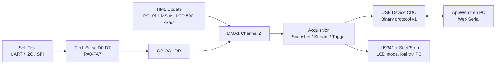
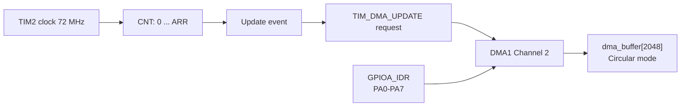
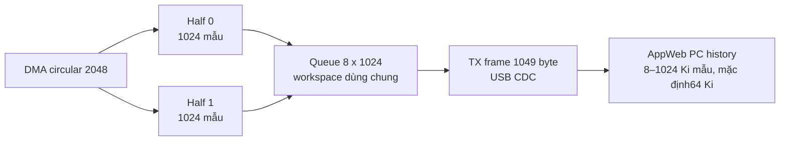
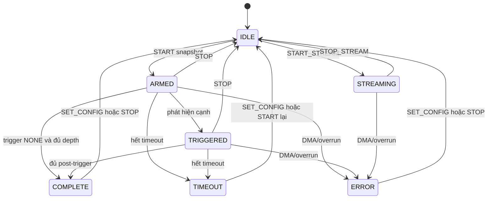
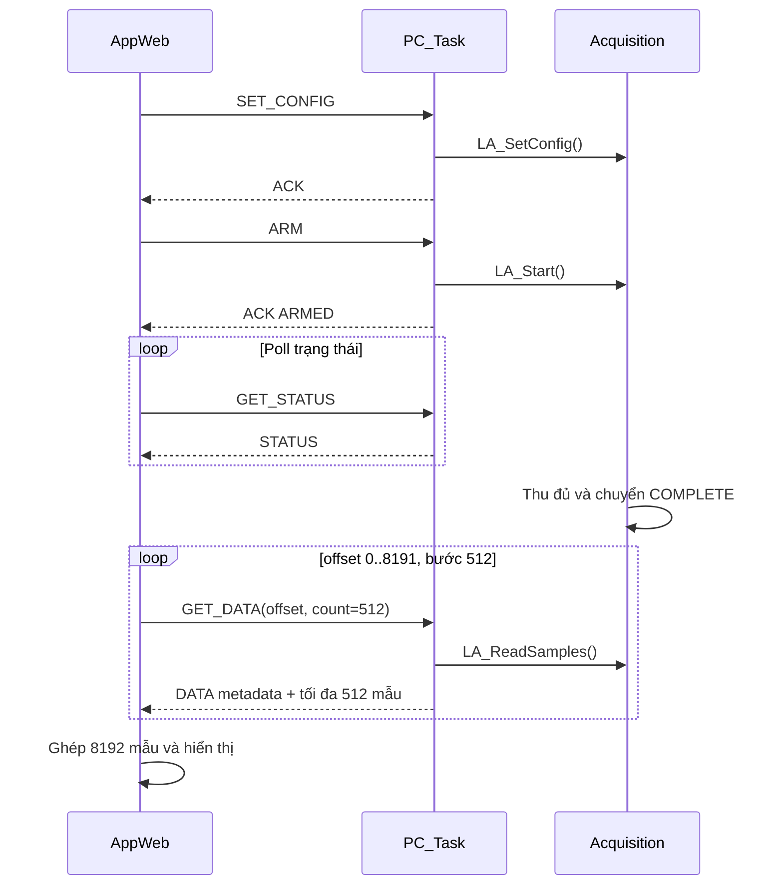
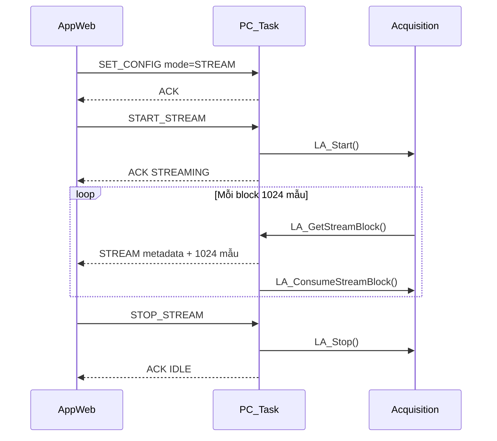

# Kiến trúc hệ thống Logic Analyzer STM32F103

## 1. Mục đích tài liệu

Tài liệu này mô tả kiến trúc **đang tồn tại trong source code hiện tại** của hệ
thống Logic Analyzer dùng STM32F103C8T6. Nội dung bao gồm phần cứng, firmware,
cơ chế lấy mẫu, bộ đệm, trigger, USB CDC, ứng dụng Web trên PC, Self Test và
module hiển thị ILI9341.

Các trạng thái tích hợp hiện tại:

- PB5 được đọc ổn định 20 ms khi reset: HIGH/hở=PC, LOW/GND=LCD.
- PC: LA_Task, PC_Task, SelfTest_Task; USB CDC/AppWeb hoạt động.
- LCD: LA_Task, Display_Task; không enumerate USB hoặc chạy Self Test.
- PB6 Start / PB7 Stop; LCD thu 4096 mẫu ở 500 kSa/s rồi phát lại chậm, SPAN=2 ms.
- HAL-based, không RTOS, không malloc; LCD và PC dùng chung bộ lấy mẫu nhưng
  chỉ một consumer hoạt động trong một phiên boot.
- Xem [LCD_MODE_GUIDE.md](LCD_MODE_GUIDE.md) để đấu dây và kiểm thử.

## 2. Sơ đồ ngữ cảnh hệ thống



Đường dữ liệu chính đang hoạt động:

```text
PA0-PA7 -> GPIOA_IDR -> TIM2 Update DMA -> DMA buffer
        -> Acquisition -> USB CDC -> AppWeb
```

## 3. Nền tảng phần cứng

### 3.1 Vi điều khiển và clock

| Thành phần | Cấu hình hiện tại |
|---|---|
| MCU | STM32F103C8T6, Cortex-M3 |
| Flash danh định | 64 KiB |
| SRAM | 20 KiB |
| HSE | 8 MHz |
| PLL | HSE x 9 |
| SYSCLK/HCLK | 72 MHz |
| APB1 | 36 MHz |
| Clock timer APB1 | 72 MHz |
| USB clock | 48 MHz |
| Công cụ build | Keil MDK-ARM V5, ArmClang |

TIM2 thuộc APB1. Do prescaler APB1 bằng 2, clock cấp cho timer được nhân đôi,
vì vậy TIM2 chạy ở 72 MHz.

### 3.2 Phân bổ chân

| Chức năng | Chân | Cấu hình |
|---|---|---|
| D0-D7 | PA0-PA7 | GPIO input, no-pull |
| USB DM/DP | PA11/PA12 | USB Full Speed Device |
| SWD | PA13/PA14 | SWDIO/SWCLK |
| UART Self Test TX/RX | PA9/PA10 | USART1, 115200 8-N-1 |
| Xung vuông kiểm tra | PB0 | GPIO output, toggle từ SysTick |
| MODE / START / STOP | PB5 / PB6 / PB7 | Input pull-up; MODE đọc khi reset, nút nhấn xuống GND |
| LCD DC/RST/CS | PB10/PB11/PB12 | GPIO output |
| SPI2 SCK/MOSI | PB13/PB15 | ILI9341 hoặc SPI Self Test |

PA0-PA7 hiện nối trực tiếp vào GPIO của STM32. Đầu vào chỉ phù hợp với logic
3,3 V; không được đưa trực tiếp tín hiệu 5 V, điện áp âm hoặc tín hiệu chưa có
mạch bảo vệ phù hợp.

### 3.3 Xung đột tài nguyên tùy chọn

ILI9341 và Self Test dùng chung một số chân:

| Chân | ILI9341 | Self Test |
|---|---|---|
| PB10 | DC | I2C SCL giả lập |
| PB11 | RESET | I2C SDA giả lập |
| PB13 | SPI2 SCK | SPI test clock |
| PB15 | SPI2 MOSI | SPI test data |

LCD mode không khởi tạo Self Test; PC mode không khởi tạo Display. Không chạy hai
consumer cùng lúc. PB8/PB9 không còn điều khiển màn hình.

## 4. Kiến trúc firmware

### 4.1 Mô hình thực thi

Firmware dùng mô hình cooperative super-loop, không có RTOS:

~~~c
while (1)
{
    LA_Task();
    if (AppMode_IsLcd())
        Display_Task();
    else {
        PC_Task();
        SelfTest_Task();
    }
}
~~~

Mode được chọn trong USER CODE trước USB init; LCD mode trả về trước USBD_Init.
Các peripheral SPI2/USART1 vẫn được CubeMX khởi tạo chung nhưng chỉ nhánh mode
tương ứng sử dụng. SysTick không gọi SelfTest_Tick1ms trong LCD mode.

Ngắt chỉ thực hiện công việc ngắn:

- DMA Half/Complete callback tăng bộ đếm block đã hoàn tất.
- DMA Error callback đặt cờ lỗi.
- USB RX callback chép byte nhận được vào RX ring.
- SysTick duy trì HAL tick, Self Test và xung PB0.

Việc quét trigger, sao chép capture, parse protocol, gửi USB và vẽ LCD được xử
lý trong vòng lặp chính.

### 4.2 Các module chính

| Module | Trách nhiệm |
|---|---|
| `Core/Src/main.c` | Khởi tạo CubeMX/HAL, clock, GPIO, DMA, TIM2, SPI2, USART1, USB và gọi các task |
| `Core/Src/acquisition.c` | Cấu hình sample rate, điều khiển TIM2/DMA, trigger, snapshot, stream, trạng thái và lỗi |
| `Core/Src/pc_interface.c` | Binary protocol, RX parser, ACK/NACK, status, tải capture và truyền stream |
| `USB_DEVICE/App/usbd_cdc_if.c` | Adapter giữa STM32 USB Device CDC và `PC_USB_Receive()`/`CDC_Transmit_FS()` |
| `Core/Src/self_test.c` | Phát chuỗi mẫu UART, I2C và SPI để kiểm thử decoder |
| `Core/Src/lcd_mode.c` | ILI9341, bộ gom frame LOW/HIGH, Start/Stop, render theo bước 128 byte pixel |
| `Core/Src/main.c` (USER CODE) | AppMode_Init/IsLcd chọn PC/LCD khi boot từ PB5 |
| `Core/Src/stm32f1xx_it.c` | DMA, USB, UART, SPI, SysTick và các IRQ handler |
| `AppWeb/` | Kết nối Web Serial, điều khiển thiết bị, waveform, đo lường và decoder |

### 4.3 Mức API

Firmware chủ yếu dùng STM32 HAL:

- `HAL_TIM_Base_Init/Start/Stop()`
- `HAL_DMA_Start_IT()`
- `HAL_GPIO_Init/ReadPin/WritePin()`
- `HAL_SPI_Transmit()`
- `HAL_UART_Transmit_IT()`
- STM32 USB Device Middleware

Một số truy cập thanh ghi trực tiếp được dùng có chủ đích:

- DMA đọc trực tiếp `GPIOA->IDR`.
- Đọc `RCC->CFGR` để xác định clock timer APB1.
- Ghi `TIMx->EGR = TIM_EGR_UG` để cập nhật PSC/ARR.

Do đó có thể mô tả kiến trúc là **HAL-based firmware with selective
register-level optimization**.

## 5. Kiến trúc lấy mẫu

### 5.1 Định dạng một mẫu

Một lần DMA đọc byte thấp của `GPIOA_IDR`. Mỗi mẫu là một `uint8_t` chứa đồng
thời trạng thái của cả 8 kênh:

```text
bit 7  bit 6  bit 5  bit 4  bit 3  bit 2  bit 1  bit 0
 D7     D6     D5     D4     D3     D2     D1     D0
 PA7    PA6    PA5    PA4    PA3    PA2    PA1    PA0
```

Nhờ đọc một thanh ghi GPIO duy nhất, tám kênh có cùng chỉ số mẫu; không tồn tại
độ lệch do phần mềm lần lượt gọi hàm đọc từng GPIO.

### 5.2 Tạo sample rate bằng TIM2

TIM2 chạy từ clock 72 MHz với `PSC = 0`. Tần số Update là:

```text
Fs = 72 MHz / (ARR + 1)
```

Firmware tính:

```text
divider = round(timer_clock / requested_rate)
ARR     = divider - 1
actual  = timer_clock / divider
```

| Sample rate | ARR | Chu kỳ mẫu |
|---:|---:|---:|
| 1 kSa/s | 71999 | 1 ms |
| 5 kSa/s | 14399 | 200 us |
| 10 kSa/s | 7199 | 100 us |
| 50 kSa/s | 1439 | 20 us |
| 100 kSa/s | 719 | 10 us |
| 500 kSa/s | 143 | 2 us |
| 1 MSa/s | 71 | 1 us |

Các mức hiện hỗ trợ đều chia chính xác từ 72 MHz. Sai số thực tế còn phụ thuộc
dung sai HSE, PLL, ngưỡng GPIO và đường tín hiệu vật lý.

### 5.3 TIM2 Update -> DMA1 Channel 2 -> SRAM



Cấu hình DMA:

| Thuộc tính | Giá trị |
|---|---|
| Request | TIM2_UP |
| Channel | DMA1 Channel 2 |
| Direction | Peripheral-to-memory |
| Peripheral address | `&GPIOA->IDR` |
| Peripheral increment | Disable |
| Memory increment | Enable |
| Peripheral alignment | Half-word |
| Memory alignment | Byte |
| Mode | Circular |
| Priority | Very High |
| DMA transfer length | 2048 mẫu |

DMA buffer chia thành hai nửa 1024 mẫu. Half-transfer và transfer-complete
callback chỉ tăng `produced_blocks`; `LA_Task()` xử lý block trong main loop.

### 5.4 Bộ đệm

```text
workspace:      8192 byte = union capture[8192] / stream_queue[8][1024] / LCD_Stream
dma_buffer:     2048 byte = 2 x 1024 mẫu
stream block:   1024 byte = 1024 mẫu
```

Các kích thước là lũy thừa của hai để circular buffer có thể wrap bằng phép
`index & (depth - 1)` thay cho phép chia lấy dư.

## 6. Snapshot/Capture mode

### 6.1 Cấu hình hỗ trợ

| Thuộc tính | Giá trị |
|---|---|
| Sample rate | 1/5/10/50/100/500 kSa/s, 1 MSa/s |
| Sample depth | 1024/2048/4096/8192 |
| Trigger | NONE, RISING, FALLING |
| Trigger channel | D0-D7 |
| Pre-trigger | 0-90% ở firmware; AppWeb dùng các mức giao diện đã định nghĩa |
| Timeout | 0 là vô hạn, khác 0 tính bằng ms |

AppWeb chọn `sample_depth`1024/2048/4096/8192 trên toolbar và gửi qua SET_CONFIG.
Giá trị mặc định nội bộ sau reset là4096; Web đọc CONFIG để đồng bộ trước khi Start.

### 6.2 Capture không trigger

Với `LA_TRIGGER_NONE`, firmware lưu liên tiếp đến khi đủ `sample_depth`, sau đó
dừng TIM2/DMA và chuyển sang `COMPLETE`.

### 6.3 Capture có trigger

Trước trigger, `capture_buffer` hoạt động như circular buffer. Mẫu mới thay thế
mẫu cũ nhất, nhờ đó hệ thống luôn giữ được lịch sử gần sự kiện nhất.

Khi phát hiện cạnh:

1. Mẫu hiện tại được xem là mẫu trigger.
2. `capture_start` được tính để trigger nằm tại `pre_samples`.
3. Trạng thái chuyển từ `ARMED` sang `TRIGGERED`.
4. Firmware lưu thêm `sample_depth - pre_samples - 1` mẫu.
5. TIM2 và DMA dừng; trạng thái chuyển sang `COMPLETE`.

```text
[pre-trigger samples] [trigger sample] [post-trigger samples]
```

PC đọc dữ liệu theo thứ tự logic bằng:

```text
capture_buffer[(capture_start + offset) & (sample_depth - 1)]
```

### 6.4 Độ phân giải trigger

Trigger được phát hiện bằng cách so sánh hai mẫu liên tiếp. Với chu kỳ mẫu
`Ts = 1/Fs`, cạnh thực nằm giữa hai thời điểm lấy mẫu, nên sai số lượng tử thời
gian nhỏ hơn một chu kỳ mẫu. Trigger hiện là software trigger sau DMA, không
phải trigger phần cứng ở chân EXTI.

## 7. Streaming mode

PC streaming dùng workspace 8192 byte làm FIFO tám block, thay cho capture buffer.
DMA vẫn ghi riêng vào buffer vòng 2048 byte; mỗi nửa 1024 mẫu hoàn tất được copy
vào FIFO trong main loop. Capture, stream và LCD loại trừ nhau trong union.



Firmware cho phép tối đa tám block đang chờ, ngoài TX frame đang truyền:

- Nếu TX sẵn sàng, `PC_Task()` chép block vào `tx_buffer`, đóng frame và gửi.
- Chỉ consume queue sau khi đã copy vào TX và BuildFrame thành công.
- TX buffer thuộc USB cho tới khi `TxState=0`, không ghi đè khi BUSY/in-flight.
- Counter DMA và CNDTR được kiểm tra trước/sau copy để loại block có nguy cơ bị
  ghi đè. Queue đầy hoặc DMA quá hạn: `OVERRUN`, tăng `dropped_blocks`, dừng
  TIM2/DMA và chuyển `ERROR`; không drop block rồi tiếp tục âm thầm.

PC stream firmware 1.4 chấp nhận 1/5/10/50/100/500 kSa/s; từ chối 1 MSa/s.
Firmware 1.5 giữ các rate này, bổ sung flags `0x0005` cho queue đầy và `0x0009`
cho DMA xử lý quá trễ; STATUS vẫn 20 byte, binary protocol vẫn version 1.
500 kSa/s cần khoảng 512207 byte/s frame, block mới mỗi 2,048 ms. FIFO 8192
byte chỉ hấp thụ jitter ngắn (16,384 ms dữ liệu ở 500 kSa/s), không bù được USB/PC
chậm liên tục. CRC16 lookup table 512 byte nằm trong Flash. LCD giữ entry point,
buffer recording, phát lại và cơ chế scroll riêng như trước.

## 8. Máy trạng thái Acquisition



Các lỗi chính:

| Lỗi | Ý nghĩa |
|---|---|
| `INVALID_CONFIG` | Mode, rate, depth, trigger hoặc pre-trigger không hợp lệ |
| `BUSY` | Thay đổi config/start khi acquisition đang chạy |
| `DMA` | HAL DMA báo lỗi |
| `OVERRUN` | Main loop/USB không xử lý block trước khi DMA quay vòng |
| `NOT_READY` | Dữ liệu chưa sẵn sàng hoặc Self Test chưa đúng trạng thái |
| `BAD_PACKET` | Frame command sai kích thước, CRC hoặc command không hỗ trợ |

## 9. Giao tiếp USB CDC

### 9.1 Cấu hình USB

| Thuộc tính | Giá trị |
|---|---|
| USB class | CDC, Virtual COM Port |
| Bus speed | USB Full Speed, 12 Mbit/s |
| USB clock | 48 MHz |
| Bulk IN endpoint | `0x81` |
| Bulk OUT endpoint | `0x01` |
| Max packet size | 64 byte |
| CDC RX buffer | 1024 byte |
| CDC TX buffer CubeMX | 1024 byte |
| Protocol RX ring | 256 byte |
| Protocol TX buffer | 1100 byte |

USB CDC không bị giới hạn bởi baud rate UART 115200. Line Coding của COM ảo
không quyết định băng thông truyền USB trong kiến trúc này.

### 9.2 Binary protocol v1

```text
+--------+---------+------+-----+--------+---------+--------+
| A5 5A  | Version | Type | Seq | Length | Payload | CRC-16 |
| 2 byte | 1 byte  | 1 B  | 1 B | 2 byte | N byte  | 2 byte |
+--------+---------+------+-----+--------+---------+--------+
```

- Multi-byte fields dùng little-endian.
- CRC là CRC-16/CCITT-FALSE, init `0xFFFF`, polynomial `0x1021`.
- CRC được tính từ `Version` đến hết `Payload`.
- Chỉ có một frame TX queued/in-flight tại một thời điểm.
- USB middleware tự chia frame thành các packet vật lý 64 byte.

### 9.3 Command và response

| Command | Mã | Response chính |
|---|---:|---|
| `GET_INFO` | `0x01` | `INFO 0x82` |
| `GET_STATUS` | `0x02` | `STATUS 0x83` |
| `GET_CONFIG` | `0x03` | `CONFIG 0x84` |
| `SET_CONFIG` | `0x04` | ACK/NACK |
| `ARM` | `0x05` | ACK/NACK |
| `STOP` | `0x06` | ACK/NACK |
| `GET_DATA` | `0x07` | `DATA 0x85` |
| `START_STREAM` | `0x08` | ACK/NACK + `STREAM 0x86` |
| `STOP_STREAM` | `0x09` | ACK/NACK |
| `RUN_SELF_TEST` | `0x0A` | ACK/NACK |
| `STOP_SELF_TEST` | `0x0B` | ACK/NACK |

Firmware hiện báo phiên bản1.5, tám kênh, tối đa8192 mẫu và tối đa1 MSa/s capture.

## 10. Luồng truyền Capture

Capture dùng mô hình pull: STM32 giữ dữ liệu trong RAM, PC chủ động yêu cầu từng
chunk sau khi trạng thái là `COMPLETE`.



Một DATA frame đủ 512 mẫu có kích thước:

```text
9 byte frame + 16 byte metadata + 512 byte mẫu = 537 byte
```

Capture 8192 mẫu cần 16 lệnh `GET_DATA`.

## 11. Luồng truyền Stream

Stream dùng mô hình push: sau `START_STREAM`, STM32 chủ động gửi frame khi một
block 1024 mẫu sẵn sàng.



Một STREAM frame có kích thước:

```text
9 byte frame + 16 byte metadata + 1024 byte mẫu = 1049 byte
```

## 12. Ứng dụng PC AppWeb

AppWeb là ứng dụng HTML/CSS/JavaScript chạy cục bộ trên Chrome hoặc Edge:

```text
cd AppWeb
run_web_app.bat
```

hoặc:

```text
python -m http.server 8080 --bind 127.0.0.1
```

Sau đó mở `http://localhost:8080`. Dữ liệu đi trực tiếp qua Web Serial, không
được gửi lên server Internet.

Các chức năng chính:

- Capture1024/2048/4096/8192 mẫu và streaming rolling history.
- Waveform tám kênh trên Canvas.
- Zoom, pan, cursor A/B, delta-t và 1/delta-t.
- Snap cursor vào cạnh, di chuyển đến cạnh trước/sau.
- Logic level tại cursor, frequency, period, duty, high/low width.
- Trigger channel, edge và pre-trigger.
- UART5–9 bit/parity/stop/order/RX/TX, I2C7-bit và SPI mode0–3/1–32 bit/CS polarity.
- Decoder lanes riêng trên cùng timeline; bảng Data/Frame/Transaction dùng shared record IDs.
- SessionJSONv2 (đọc v1), raw/decoded/measurement CSV, VCD, PNG và log có bộ lọc.
- Điều khiển Self Test UART/I2C/SPI.

AppWeb chọn PC history8/64/256/1024 Ki mẫu, mặc định64 Ki. Trong Stream mode,
các mẫu cũ nhất bị loại theo dung lượng này; đây là retention trên PC, không phải
DMA buffer hay mất mẫu USB. Pause Follow giữ thêm một snapshot để phân tích.
Parser dùng Uint8Array 65536 byte và read/write cursor, xử lý frame rời rạc hoặc
gộp trong USB chunk. Mỗi block được kiểm tra CRC, ID, sequence modulo 256 và
first_sample modulo2^32 rồi copy vào ring. Incremental Decoder nhận **mọi block**;
không phụ thuộc nhịp UI. Sample index được tích lũy không wrap cho timeline PC.
Snapshot/vẽ tối đa20 lần/giây và giảm nhịp với history lớn; một RAF chờ vẽ.
Phép đo streaming chạy trong worker, response chỉ áp dụng cho đúng snapshot/range.
Raw dùng cho decode/measurement; bins giữ min/max chỉ phục vụ vẽ xung ngắn.
Không có markerT hay thời gian âm giả trong stream. Cursor giữ index tuyệt đối.
Sai continuity/CRC/flags hoặc STATUS ERROR sẽ Stop stream, giữ prefix hợp lệ và
sticky ERROR đến Start mới. Poll STATUS vẫn chạy khi STREAMING để thấy MCU OVERRUN.
Web Serial buffer 1 MiB được tạo khi mở COM, thuộc PC; parser vẫn 64 KiB. Đây
là dự trữ cho các đợt JS bận, không tăng queue/throughput của STM32. ACK được
log theo state MCU trả về; UI có thể tiếp tục giữ ERROR của phiên vừa dừng.

Web được tách theo trách nhiệm: `app.js` là transport/controller,
`analysis.js` là engine thuần, `workbench.js` là view/session/history,
`analysis_worker.js` dùng lại phép đo trong worker. Giới hạn record/log/table,
chi tiết thuật toán, audit và kiểm thử xem [AppWeb/README.md](../AppWeb/README.md).
Thay đổi Web này giữ nguyên firmware, pin mapping, .ioc và Keil project.
Save/Export lưu cửa sổ hiện tại, không ghi toàn phiên streaming vào đĩa.

## 13. Self Test

Self Test cho phép kiểm thử decoder mà không cần thiết bị phát tín hiệu ngoài.
Firmware mặc định không phát protocol cho đến khi nhận `RUN_SELF_TEST`.

| Chế độ | Tín hiệu | Loopback cần nối |
|---|---|---|
| UART | `55 AA 45 54 56 49 45 57 0D 0A` | PA9 -> PA0/D0 |
| I2C | START, A0 ACK, 55 ACK, AA ACK, STOP | PB10 -> PA0, PB11 -> PA1 |
| SPI | `55 AA A5 5A`, mode 0 | PB13 -> PA0, PB15 -> PA1 |

AppWeb chọn sample rate an toàn tương ứng:

- UART: 100 kSa/s.
- I2C: 10 kSa/s.
- SPI: 500 kSa/s.

Self Test chỉ nên dùng cho kiểm tra luồng thu và decoder; nó không thay thế phép
đo với bus UART/I2C/SPI thực tế.

## 14. Module màn hình ILI9341

LCD thu 4096 mẫu/8,192 ms ở 500 kSa/s, dừng DMA rồi phát lại chậm.
PB6 Start, PB7 Stop, debounce 20 ms. PC capture/streaming giữ nguyên.
Sidebar x=0..63 cố định: thông số x=2..43, nhãn D0–D7 x=48..59.
Giữ Fs, REC/PLAY/IDLE/ERROR, FPS, số mẫu và hướng dẫn nút; không hiển thị thời gian.
Không hiển thị SPAN, SLOW hoặc HOLD; trạng thái giữ hình vẫn hoạt động.
Waveform x=64..319, y=0..239; tám lane cao 30 pixel.

MADCTL=0x28 landscape: VSCRDEF 0x33 cấu hình 64 fixed + 256 scroll + 0 fixed.
Vẽ 256 cột đầu một lần. Mỗi bước chỉ ghi tối đa 3 cột vào GRAM cũ nhất,
sau đó commit VSCRSADD 0x37 để dịch nguyên khối ảnh cũ. Pointer có giá trị
64+head, head wrap 0..255. Tất cả waveform dịch cùng bước, sidebar đứng yên.
Không blank display, không full framebuffer, không thêm SPI DMA.

LCD_GetColumn gom raw trên lưới cột tuyệt đối: cửa sổ 1000 mẫu/2 ms trên
256 pixel, 7,8125 µs/pixel. Mỗi bước 3 pixel khoảng 23,44 µs dữ liệu.
Cạnh giữa bin được nối; không thể đếm số xung trong một bin hỗn hợp.
Mỗi lần gửi tối đa 64 pixel/128 byte. Bước thường chỉ gửi 1440 byte waveform.
Mục tiêu 10 bước/s; FPS là số commit thực đo, có một chữ số thập phân.

4096 mẫu có 1048 cột đủ dữ liệu, hai mẫu đuôi vẫn giữ trong raw nhưng không vẽ
thành bin chưa đủ. Vị trí cuối: cột 792, T=6188 µs, rồi HOLD, không nối vòng
cuối bản ghi về đầu. Stop khi đang ghi hoàn tất bước trước khi HOLD.
Start ở HOLD thu mới và reset pointer; Start khi REC/PLAY được bỏ qua.
SPI lỗi không được commit pointer tiếp, cần kiểm tra/reset.

Hardware scroll theo trục native cần đối chiếu chiều scan trên module thật.
Trong lúc ghi dải mới có thể có thay đổi nhỏ tại mép trái trước commit;
không cam kết chống tearing tuyệt đối. Xem LCD_MODE_GUIDE.md để test board.

## 15. Phân bổ SRAM

Rebuild PC/LCD mới bằng Keil ArmClang V6.24: 0 error, 0 warning.

| Hạng mục | Byte |
|---|---:|
| SRAM | 20480 |
| RW-data | 400 |
| ZI-data, đã gồm stack/heap reserve | 18416 |
| Tổng RW_IRAM1 | 18816 |
| Chưa phân bổ | 1664 |

workspace union chiếm 8192 byte: PC dùng capture raw hoặc queue stream 8 block; LCD dùng LCD_Stream
(recording 4096 byte và pixel scratch, không còn hai frame masks). DMA buffer riêng 2048 byte.
USB/protocol/HAL vẫn có biến tĩnh trong cả hai mode dù LCD không khởi tạo USB.
RAM chưa phân bổ không đồng nghĩa với số RAM trống thực tế của stack lúc chạy.
Cần theo dõi stack high-water trên board.

## 16. Quy tắc cạnh tranh tài nguyên và thứ tự task

1. `LA_Task()` chạy trước để xử lý block DMA sớm nhất có thể.
2. `PC_Task()` chạy sau để parse command và truyền dữ liệu.
3. Self Test chạy sau giao tiếp PC.
4. LCD mode chỉ chạy Display_Task sau LA_Task; mỗi bước SPI nhỏ để phục vụ DMA kịp.
5. `SET_CONFIG` trong `ARMED`, `TRIGGERED` hoặc `STREAMING` trả `BUSY`.
6. PC chỉ gửi command mới sau khi command trước đã có response.
7. Chỉ một USB TX frame được queued/in-flight tại một thời điểm.
8. Stream queue giữ tối đa tám block; đầy queue hoặc DMA quá hạn tạo `OVERRUN`
   thay vì âm thầm trả waveform thiếu dữ liệu.

## 17. Các quyết định kiến trúc chính

| Quyết định | Lý do |
|---|---|
| 8 kênh trên cùng GPIOA | Một lần đọc `GPIOA_IDR` thu đồng thời D0-D7 |
| Một byte cho tám kênh | Giảm SRAM và băng thông USB |
| TIM2 Update kích DMA | Sample period đều, CPU không đọc từng mẫu |
| DMA circular 2 x 1024 | Ping-pong half/full callback |
| Trigger xử lý trong main loop | ISR ngắn, dễ debug |
| Capture circular trước trigger | Giữ lịch sử gần nhất trước sự kiện |
| Capture truyền theo chunk 512 | Không cần TX buffer 8 KiB, dễ kiểm tra offset/CRC |
| Stream block 1024 | Cân bằng latency và overhead |
| Fail-fast khi overrun | Không trả dữ liệu thiếu mà không báo lỗi |
| Web Serial local | Không cần backend, dữ liệu không rời máy tính |
| LCD vẽ theo đoạn 64 pixel | Không cần framebuffer; nhường CPU giữa các bước |
| workspace union capture/stream/LCD | Dùng lại 8 KiB cho FIFO stream hoặc recording và scratch LCD |

## 18. Giới hạn và rủi ro hiện tại

- 1 MSa/s là sample rate, không đồng nghĩa giải mã đáng tin cậy tín hiệu 1 MHz.
- Đo duty, pulse width và decode nên có nhiều mẫu trên mỗi bit/chu kỳ; thực tế
  nên ưu tiên ít nhất khoảng 8-10 mẫu trên một khoảng cần phân tích.
- Snapshot 1 MSa/s đã từng xuất hiện `OVERRUN`; chưa được phép coi là ổn định
  trên mọi tải nếu chưa hoàn thành stress test phần cứng.
- Stream 500 kSa/s đã mở trong phần mềm, chưa xác nhận chạy bền trên phần cứng;
  cần stress test USB/PC và theo dõi dropped_blocks. Queue không tạo thêm băng thông.
- RX ring chỉ 256 byte; PC phải tuân thủ mô hình một command tại một thời điểm.
- SRAM đã dùng ở mức cao; cần kiểm tra stack trên phần cứng.
- Display và I2C/SPI Self Test trùng chân, đã tách bằng mode boot.
- LCD phát lại chậm một đoạn thu; tốc độ thu 500 kSa/s và FPS cần test trên board.
- Chưa có mạch bảo vệ đầu vào đáp ứng điện áp cao; PA0-PA7 hiện là đầu vào 3,3 V.
- Sai số clock HSE, jitter, skew vật lý và ngưỡng đầu vào chưa được đo định lượng
  đầy đủ trên phần cứng.

## 19. Cấu trúc thư mục liên quan

```text
Logic_Analyzer/
├── Logic_Analyzer.ioc
├── Core/
│   ├── Inc/
│   │   ├── acquisition.h
│   │   ├── pc_interface.h
│   │   ├── self_test.h
│   │   └── lcd_mode.h
│   └── Src/
│       ├── main.c
│       ├── acquisition.c
│       ├── pc_interface.c
│       ├── self_test.c
│       ├── lcd_mode.c
│       └── stm32f1xx_it.c
├── USB_DEVICE/
│   ├── App/
│   │   ├── usb_device.c
│   │   └── usbd_cdc_if.c
│   └── Target/
│       └── usbd_conf.c
├── AppWeb/
│   ├── index.html
│   ├── styles.css
│   ├── app.js
│   └── run_web_app.bat
├── MDK-ARM/
│   ├── Logic_Analyzer.uvprojx
│   └── Logic_Analyzer/
│       ├── Logic_Analyzer.axf
│       ├── Logic_Analyzer.hex
│       └── Logic_Analyzer.map
└── docs/
    └── architecture.md
```

## 20. Nguồn đối chiếu trong project

- Cấu hình MCU và peripheral: [`../Logic_Analyzer.ioc`](../Logic_Analyzer.ioc)
- Khởi tạo và super-loop: [`../Core/Src/main.c`](../Core/Src/main.c)
- Acquisition API: [`../Core/Inc/acquisition.h`](../Core/Inc/acquisition.h)
- TIM2/DMA/trigger/buffer: [`../Core/Src/acquisition.c`](../Core/Src/acquisition.c)
- Binary protocol: [`../Core/Src/pc_interface.c`](../Core/Src/pc_interface.c)
- USB CDC adapter: [`../USB_DEVICE/App/usbd_cdc_if.c`](../USB_DEVICE/App/usbd_cdc_if.c)
- Self Test: [`../Core/Src/self_test.c`](../Core/Src/self_test.c)
- ILI9341 và nút bấm: [`../Core/Src/lcd_mode.c`](../Core/Src/lcd_mode.c)
- AppWeb: [`../AppWeb/app.js`](../AppWeb/app.js)
- Linker map: [`../MDK-ARM/Logic_Analyzer/Logic_Analyzer.map`](../MDK-ARM/Logic_Analyzer/Logic_Analyzer.map)

## 21. Quy trình kiểm tra sau khi thay đổi kiến trúc

Sau mỗi thay đổi buffer, peripheral hoặc module:

1. Regenerate CubeMX với tùy chọn giữ USER CODE nếu thay đổi `.ioc`.
2. Kiểm tra `MDK-ARM/Logic_Analyzer.uvprojx` vẫn chứa các source cần thiết.
3. Rebuild target trong Keil.
4. Xác nhận 0 error, 0 warning.
5. Kiểm tra `RW-data + ZI-data` và `RW_IRAM1` trong file map.
6. Kiểm tra capture ở tất cả sample rate/depth cần công bố.
7. Kiểm tra trigger ở biên giữa hai DMA half-buffer.
8. Stress Stream và xác nhận `dropped_blocks = 0`.
9. Kiểm tra reconnect USB và parser khi frame bị phân mảnh.
10. Kiểm tra cả boot PC/LCD, nút, 500 kSa/s, FPS và hardware scroll qua điểm wrap theo LCD_MODE_GUIDE.md.

